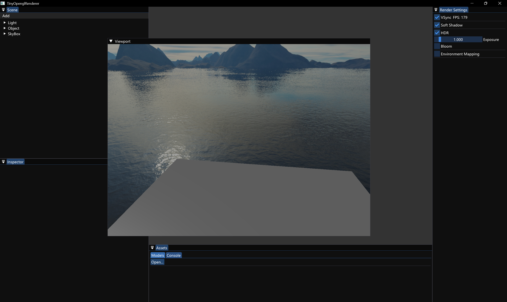
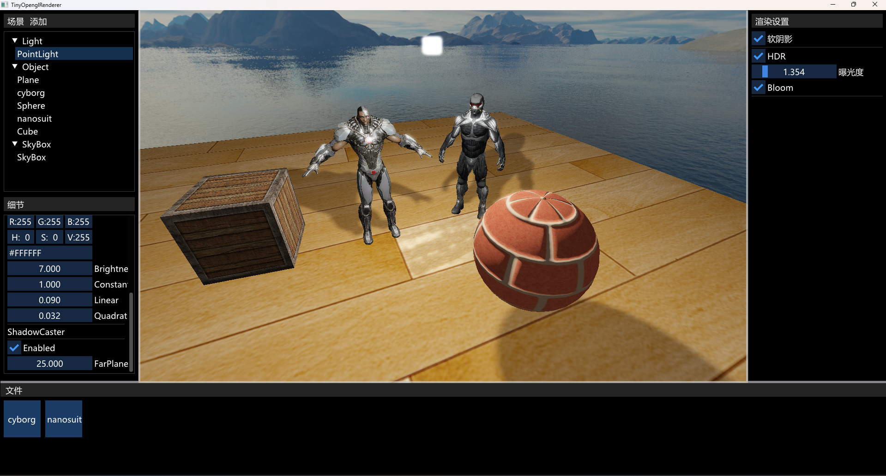

# TinyOpenGLRenderer

一个基于 **OpenGL 4.5 + C++17** 的小型实时渲染器 / 场景编辑器,用于学习与实验现代渲染技术。组件驱动的 ECS-lite 架构,RenderPass 流水线,Dear ImGui(docking)编辑器界面。

## 效果展示

### 编辑器总览(docking 布局)

### 渲染效果

### 骨骼动画

### 体积云

## 功能特性

### 渲染

- **前向 HDR 管线**:RGBA16F 渲染目标,Bloom(高斯 ping-pong 模糊),曝光色调映射
- **多光源**:平行光 / 点光 / 聚光,光源数据经 SSBO 上传
- **阴影**:平行光 2D shadow map;点光 cube map array 全向阴影
- **体积云**(Horizon 风格 raymarch):
  - Perlin-Worley 噪声排布:低频 Perlin FBM 成形 + 高频 Worley 边缘侵蚀,域扭曲,weather map 控制覆盖率
  - 双叶 HG 相位函数、4 阶多重散射近似、powder 暗边、自阴影 light march(与视线共用同一密度场)
  - 性能:半分辨率渲染 + 深度感知双边上采样、空步跳过(可证明输出等价)、世界尺度自适应步数
  - **完全组件参数化**:云类型(层云↔积云)/覆盖率/噪声尺度/光照/风速等 15 项参数,Inspector 实时可调,同场景可多朵不同的云
  - 噪声后台并行生成 + 自描述磁盘缓存(参数变化自动失效重建)
- **骨骼动画**:Assimp 导入,GPU 蒙皮,骨骼调试叠加显示
- **天空盒**、PLY / 常见模型格式异步加载

### 编辑器

- **Dear ImGui docking**:可停靠面板 —— 场景树 / Inspector / 渲染设置 / 资源 / Viewport(渲染到纹理)
- **组件式 Inspector**:Transform、光源、材质、体积云等组件均有对应编辑面板
- **选中 Gizmo**:选中物体时在其原点渲染 XYZ 轴向箭头(随物体旋转、始终最前、恒定屏幕尺寸)
- **应用内日志控制台**:GL 调试输出 / 引擎日志直接显示在编辑器内,无系统 cmd 窗口
- 数据驱动的 Add 菜单一键创建光源 / 网格 / 天空盒 / 体积云

### 架构

- **ECS-lite**:GameObject + 组件(`unordered_map<type_index, ComponentPtr>`),场景视图按类型缓存
- **RenderPass 流水线**:FrameSetup → DirectionalShadow → PointShadow → LightUpload → ForwardHdr → VolumeSkeleton → Gizmo → Bloom → Composite,各 pass 仅通过 RenderContext 共享状态
- **依赖注入**:Engine 为组合根,系统间以非拥有指针注入,无单例(Logger 除外)
- **GL 资源 RAII**:纹理 / FBO / Buffer 均为 move-only 包装,显式 shutdown 防 context 期外释放

## 构建

- **环境**:Windows + Visual Studio 2022(v143),x64,C++17
- 依赖已捆绑在仓库内(`include/` + `lib/`),无需额外安装:
  | 库 | 用途 |
  |---|---|
  | GLFW | 窗口 / 输入 |
  | glad | GL 4.5 加载 |
  | glm | 数学 |
  | Assimp | 模型 / 动画导入 |
  | Dear ImGui(docking)+ ImGuiFileDialog | 编辑器 UI |
  | stb_image | 贴图加载 |

打开 `TinyOpenGLRenderer.sln`,选 Debug/Release x64 直接生成运行。启动后自动加载带天空盒、地面与平行光的默认场景。

## 操作

| 输入 | 行为 |
|---|---|
| `W / A / S / D` | 相机平移 |
| `Space / 左 Ctrl` | 相机升 / 降 |
| 鼠标移动 | 视角(光标禁用时) |
| 滚轮 | 缩放(FOV) |
| `左 Alt` | 切换光标显示 / 锁定 |
| `Esc` | 退出 |

场景树中左键选中物体(出现 XYZ gizmo),右键可删除;Inspector 中实时编辑组件参数。
